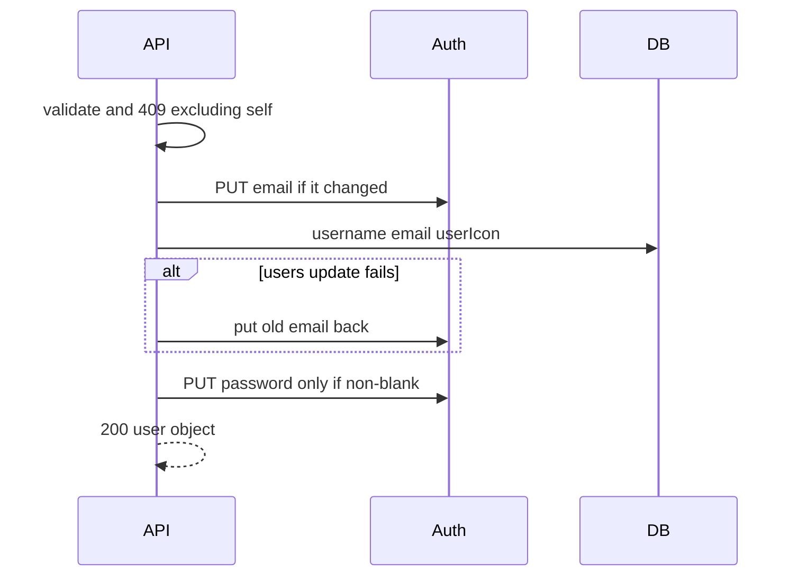

# B2 — email and password

Slice 2 of 2. Depends on [B1](userprofile_b1_read.plan.md). Spec: [userprofile-backend.spec.md](userprofile-backend.spec.md).

Only after B1 is reviewed. Same `PATCH /api/users/me`. Response stays `{ "user": { id, username, email, userIcon } }`.

## Decisions not in the spec

**Important**

- `email`: trimmed and lowercased, same shape as signup. Update `users.email` and Auth. Duplicate email → 409 before Auth is called. Message already exists: `Email already exists`. Saving your own email is 200. A present email that is blank is 400.
- Caller keeps the old access token. `GET /api/users/me` with that token returns the new `users.email`. `GET /api/auth/me` can still show the old email claim until the client refreshes. Do not mint a new token here.
- `password`: `""` or omitted → Auth password unchanged. Non-blank → Auth password only (nothing in `users`). Shorter than 6 → 400 and the old password still works. Confirm-password stays a frontend check.
- Auth changes use the existing service-role client: `PUT /auth/v1/admin/users/{inner_id}`. Email updates send `email_confirm: true`. The response does not include a new session.
- Order: validate, then 409 checks that exclude this user, then Auth email, then the `users` row, then Auth password. If the row update fails after the Auth email changed, put the old Auth email back. Password is last because we cannot put the old password back. If that last call fails, username, icon, and email stay saved and the API returns 500.

**Noise — keep unless you say otherwise**

- `UserProfileService` calls `SupabaseAuthService`. RestClient, no Supabase SDK.
- 400 via existing `InvalidRequestException`.
- No generated tests. Test rows use `test-can-delete-later` in the username.



## Lands

- `email` and `password` on the B1 PATCH.
- [`SupabaseAuthService`](../../backend/src/main/java/com/lifequest/service/SupabaseAuthService.java): admin update for email and password.
- [`UserRepository`](../../backend/src/main/java/com/lifequest/repository/UserRepository.java): `existsByEmailAndIdNot`.

Does not land: `profileUrl`, photo upload, frontend save wiring, token refresh.

## Test

Implementer and tester are different agents. The implementer does not run this section.

Backend already on `http://localhost:8080`. No generated tests. Reuse the B1 user, or sign up a fresh `test-can-delete-later-*` pair the same way as [B1](userprofile_b1_read.plan.md). `$token` is the access token from login with the original email. `$email` and `$password` are that user's original email and `secret1`. `$stamp` is the same stamp used at signup.

```powershell
$newEmail = "test-can-delete-later-new-$stamp@lifequest.test"

# 200 — users.email and Auth email change; this token is still the one from login
curl.exe -s -w "`nHTTP:%{http_code}" -X PATCH "http://localhost:8080/api/users/me" `
  -H "Authorization: Bearer $token" `
  -H "Content-Type: application/json" `
  --data-binary (@{ email = $newEmail } | ConvertTo-Json -Compress)

# still 200 with the OLD token; user.email is the new one
curl.exe -s -w "`nHTTP:%{http_code}" "http://localhost:8080/api/users/me" `
  -H "Authorization: Bearer $token"

# JWT email claim can still be the old one
curl.exe -s -w "`nHTTP:%{http_code}" "http://localhost:8080/api/auth/me" `
  -H "Authorization: Bearer $token"

# login with the new email works; old email does not
curl.exe -s -w "`nHTTP:%{http_code}" -X POST "http://localhost:8080/api/auth/login" `
  -H "Content-Type: application/x-www-form-urlencoded" `
  --data-urlencode "email=$newEmail" `
  --data-urlencode "password=$password"

curl.exe -s -w "`nHTTP:%{http_code}" -X POST "http://localhost:8080/api/auth/login" `
  -H "Content-Type: application/x-www-form-urlencoded" `
  --data-urlencode "email=$email" `
  --data-urlencode "password=$password"

# 409 — other user's email; then login with $newEmail still works
curl.exe -s -w "`nHTTP:%{http_code}" -X PATCH "http://localhost:8080/api/users/me" `
  -H "Authorization: Bearer $token" `
  -H "Content-Type: application/json" `
  --data-binary '{"email":"test-can-delete-later-other-' + $stamp + '@lifequest.test"}'

# 200 — blank password keeps secret1
curl.exe -s -w "`nHTTP:%{http_code}" -X PATCH "http://localhost:8080/api/users/me" `
  -H "Authorization: Bearer $token" `
  -H "Content-Type: application/json" `
  --data-binary '{"password":""}'

curl.exe -s -w "`nHTTP:%{http_code}" -X POST "http://localhost:8080/api/auth/login" `
  -H "Content-Type: application/x-www-form-urlencoded" `
  --data-urlencode "email=$newEmail" `
  --data-urlencode "password=$password"

# 400 — too short; secret1 still works
curl.exe -s -w "`nHTTP:%{http_code}" -X PATCH "http://localhost:8080/api/users/me" `
  -H "Authorization: Bearer $token" `
  -H "Content-Type: application/json" `
  --data-binary '{"password":"123"}'

# 200 — new password
curl.exe -s -w "`nHTTP:%{http_code}" -X PATCH "http://localhost:8080/api/users/me" `
  -H "Authorization: Bearer $token" `
  -H "Content-Type: application/json" `
  --data-binary '{"password":"secret2"}'

curl.exe -s -w "`nHTTP:%{http_code}" -X POST "http://localhost:8080/api/auth/login" `
  -H "Content-Type: application/x-www-form-urlencoded" `
  --data-urlencode "email=$newEmail" `
  --data-urlencode "password=secret2"

curl.exe -s -w "`nHTTP:%{http_code}" -X POST "http://localhost:8080/api/auth/login" `
  -H "Content-Type: application/x-www-form-urlencoded" `
  --data-urlencode "email=$newEmail" `
  --data-urlencode "password=$password"
```

Expect: blank password → login `secret1` is 200. After the real change, `secret2` is 200 and `secret1` is 401. Duplicate email is 409 and `secret1` / the current email still log in.
